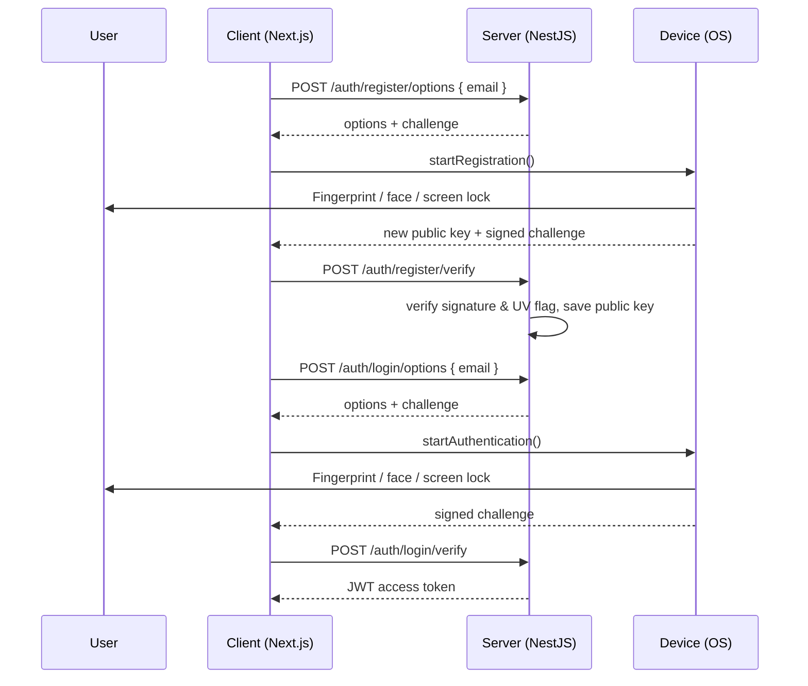

<a name="readme-top"></a>

<div align="center">

# 🔐 Passwordless Auth

**Sign up and sign in with passkeys: your fingerprint, your face, or your device's screen lock. No passwords.**

Built with [WebAuthn](https://webauthn.io/) and [SimpleWebAuthn](https://simplewebauthn.dev/docs/)

</div>

# 📗 Table of Contents

- [📖 About the Project](#about-project)
  - [🛠 Built With](#built-with)
  - [🔑 Key Features](#key-features)
  - [🧠 How It Works](#how-it-works)
- [💻 Getting Started](#getting-started)
  - [Prerequisites](#prerequisites)
  - [Setup](#setup)
  - [Install](#install)
  - [Usage](#usage)
- [📡 API Endpoints](#api-endpoints)
- [👥 Author](#author)
- [🤝 Contributing](#contributing)
- [⭐️ Show your support](#support)
- [📚 Resources](#resources)
- [📝 License](#license)

# 📖 Passwordless Auth <a name="about-project"></a>

**Passwordless Auth** is a full-stack demo of passkey authentication. Users create an account with only an email and a passkey. To sign in, the user confirms with whatever their device offers:

| Device | Verification method |
| --- | --- |
| Mac | Touch ID or Mac password |
| iPhone / iPad | Face ID, Touch ID, or passcode |
| Android | Fingerprint, face, or PIN/pattern/password |
| Windows | Windows Hello (face, fingerprint, or PIN) |
| Any other device | Scan a QR code, then confirm on your phone |

The device's operating system chooses the method. The server never sees biometric data. It only checks a signature and the **User Verified (UV)** flag, which proves the user passed the device's check.

The project is split into two apps:

```
passwordless-auth/
├── client/   # Next.js frontend (port 3000)
└── server/   # NestJS API + PostgreSQL (port 4000)
```

## 🛠 Built With <a name="built-with"></a>

<details>
  <summary>Client</summary>
  <ul>
    <li><a href="https://nextjs.org/">Next.js 15</a> + <a href="https://react.dev/">React 19</a></li>
    <li><a href="https://tailwindcss.com/">Tailwind CSS</a></li>
    <li><a href="https://simplewebauthn.dev/docs/packages/browser">@simplewebauthn/browser</a></li>
    <li><a href="https://axios-http.com/">Axios</a></li>
  </ul>
</details>

<details>
  <summary>Server</summary>
  <ul>
    <li><a href="https://nestjs.com/">NestJS 10</a></li>
    <li><a href="https://simplewebauthn.dev/docs/packages/server">@simplewebauthn/server</a></li>
    <li><a href="https://typeorm.io/">TypeORM</a> + <a href="https://www.postgresql.org/">PostgreSQL</a></li>
    <li><a href="https://docs.nestjs.com/security/authentication">JWT</a> (Passport) for sessions</li>
  </ul>
</details>

## 🔑 Key Features <a name="key-features"></a>

- **Passkey sign-up and sign-in**: no passwords are stored or sent anywhere
- **User verification required**: every sign-in needs a fingerprint, face, or screen lock
- **Discoverable, syncable passkeys**: passkeys are stored by iCloud Keychain, Google Password Manager, Windows Hello, etc.
- **Cross-device sign-in**: use your phone via QR code, or a hardware security key
- **Protections**: one-time challenges, signature counter checks, and passkeys tied to their owner's account
- **JWT-protected API** after a successful sign-in

<p align="right">(<a href="#readme-top">back to top</a>)</p>

## 🧠 How It Works <a name="how-it-works"></a>

Registration and sign-in follow the same pattern: the server sends a **challenge**, the device **signs** it after verifying the user, and the server **verifies** the result.



The private key never leaves the device. The server only stores the **public key**, so a database leak gives an attacker nothing they can sign in with.

<p align="right">(<a href="#readme-top">back to top</a>)</p>

# 💻 Getting Started <a name="getting-started"></a>

### Prerequisites

- [Node.js](https://nodejs.org/) 22+ and npm
- [PostgreSQL](https://www.postgresql.org/download/) (e.g. [Postgres.app](https://postgresapp.com/) on macOS) and optionally [pgAdmin](https://www.pgadmin.org/)
- A device with a passkey-capable authenticator (Touch ID, Face ID, Windows Hello, Android, or a security key)
- A recent Chrome, Safari, Edge, or Firefox

### Setup

Clone the repository:

```sh
git clone git@github.com:RolandM99/passwordless-auth.git
cd passwordless-auth
```

Create the database (the tables are created automatically in development):

```sh
createdb -h localhost -U postgres auth
```

> Or in pgAdmin: right-click **Databases → Create → Database…** and name it `auth`.

Create `server/.env`:

```env
JWT_SECRET=change-me-to-a-long-random-string
JWT_EXPIRATION_TIME=1h

WEBAUTHN_RP_ID=localhost
WEBAUTHN_ORIGIN=http://localhost:3000

DB_HOST=localhost
DB_PORT=5432
DB_USERNAME=postgres
DB_PASSWORD=your-db-password
DB_NAME=auth
```

Create `client/.env`:

```env
NEXT_PUBLIC_API_URL=http://localhost:4000
```

> **Note:** `WEBAUTHN_RP_ID` must be the domain the client runs on (no protocol or port), and `WEBAUTHN_ORIGIN` must match the client URL exactly. Browsers allow WebAuthn only on `https://` or `localhost`.

### Install

```sh
cd server && npm install
cd ../client && npm install
```

### Usage

Start each app in its own terminal:

```sh
# Terminal 1: API on http://localhost:4000
cd server
npm run start:dev
```

```sh
# Terminal 2: frontend on http://localhost:3000
cd client
npm run dev
```

Then open [http://localhost:3000/signup](http://localhost:3000/signup), enter your email, and confirm with your fingerprint, face, or screen lock. Sign in again at `/signin`.

<p align="right">(<a href="#readme-top">back to top</a>)</p>

# 📡 API Endpoints <a name="api-endpoints"></a>

| Method | Endpoint | Description | Auth |
| --- | --- | --- | --- |
| `POST` | `/auth/register/options` | Get passkey creation options for an email | — |
| `POST` | `/auth/register/verify` | Verify the new passkey and save it | — |
| `POST` | `/auth/login/options` | Get sign-in options for an email | — |
| `POST` | `/auth/login/verify` | Verify the signed challenge and return a JWT | — |
| `GET` | `/auth/authenticators?email=` | List the passkeys registered for a user | JWT |

<p align="right">(<a href="#readme-top">back to top</a>)</p>

# 👥 Author <a name="author"></a>

👤 **Roland Mweze**

- GitHub: [@RolandM99](https://github.com/RolandM99)
- LinkedIn: [Roland N. Mweze](https://www.linkedin.com/in/roland-mweze/)
- Twitter: [ManfulMwez](https://twitter.com/ManfulMwez)

<p align="right">(<a href="#readme-top">back to top</a>)</p>

# 🤝 Contributing <a name="contributing"></a>

Contributions, issues, and feature requests are welcome!

Feel free to check the [issues page](https://github.com/RolandM99/passwordless-auth/issues).

# ⭐️ Show your support <a name="support"></a>

If this project helped you understand passwordless authentication, please give it a ⭐️!

# 📚 Resources <a name="resources"></a>

- [passkeys.dev](https://passkeys.dev/docs/intro/what-are-passkeys/): what passkeys are and how to adopt them
- [SimpleWebAuthn docs](https://simplewebauthn.dev/docs/) and [GitHub](https://github.com/MasterKale/SimpleWebAuthn)
- [webauthn.io](https://webauthn.io/): interactive WebAuthn demo
- [W3C WebAuthn spec](https://www.w3.org/TR/webauthn-3/)

# 📝 License <a name="license"></a>

This project is [MIT](./LICENSE) licensed.

<p align="right">(<a href="#readme-top">back to top</a>)</p>
